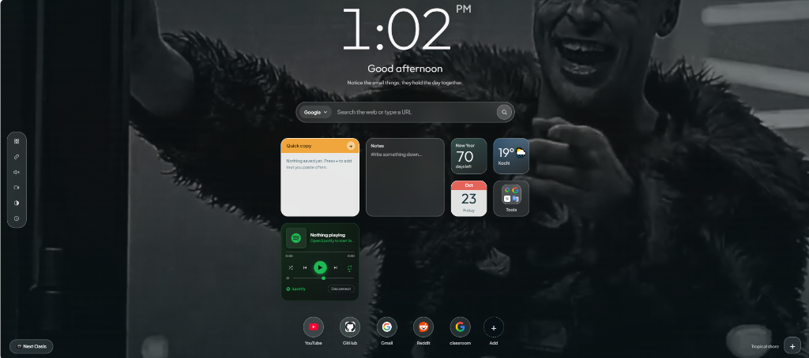
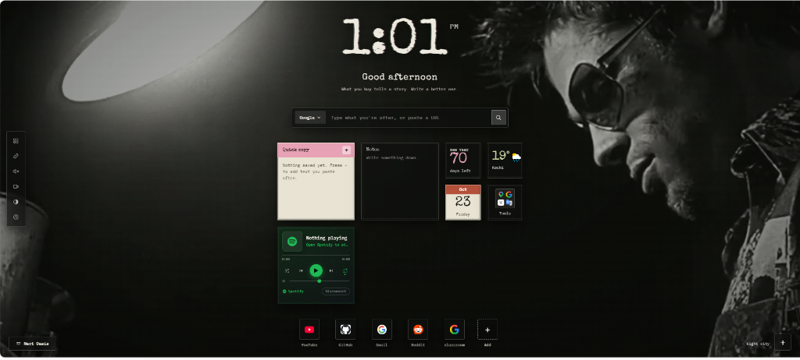

# 🌴 Oasis Tab — Chrome Extension

> A calm, glassmorphic new tab dashboard with live widgets, Spotify integration, dual themes, and ambient live wallpapers.


<p align="center">
  
  
</p>

---

## ✨ Features

- 🕒 **Live Clock & Greeting**: Dynamic time display with toggleable 12-hour/24-hour format, contextual greetings, and motivational quotes.
- 🎨 **Dual Aesthetic Themes**:
  - **Oasis**: Serene, tranquil nature photography with soft glassmorphism and modern typography.
  - **Fight Club**: Gritty monochrome typewriter style, film grain effect, and an immersive live video background.
- 🎵 **Spotify Integration**:
  - Live now-playing card with real-time album art, progress bar, play/pause, skip controls, and volume slider.
  - Secure authorization using Spotify's OAuth PKCE flow (no client secret needed).
- 🧩 **Modular Widget Grid**:
  - Weather widget powered by Open-Meteo.
  - Countdown and target tracker.
  - Mini calendar.
  - Easily toggle, add, or remove widgets on demand.
- 🔍 **Unified Multi-Engine Search**: Switch between Google, Bing, and DuckDuckGo directly from the search bar.
- 🚀 **Quick Links**: Add, edit, and organize frequently used shortcuts with automatic favicon detection.
- 🎥 **Ambient Live Wallpaper**: Video background playback with audio controls (mute/unmute rail button).

---

## 🚀 Getting Started

### 1. Installation (Developer Mode)

1. Clone or download this repository:
   ```bash
   git clone https://github.com/Ericdama/oasis.git
   ```
2. Open Google Chrome or any Chromium-based browser (Brave, Edge, Arc, Opera).
3. Navigate to `chrome://extensions/`.
4. Turn on **Developer mode** using the toggle switch in the top-right corner.
5. Click **Load unpacked** in the top-left corner.
6. Select the folder containing `manifest.json`.
7. Open a new tab to see Oasis in action!

---

### 2. Spotify Widget Setup (Optional)

To connect your Spotify account to the Now Playing widget:

1. Visit the [Spotify Developer Dashboard](https://developer.spotify.com/dashboard) and log in.
2. Click **Create app**:
   - **App name**: `Oasis Tab`
   - **App description**: `New Tab Spotify Widget`
   - **Redirect URI**: Find your extension ID on `chrome://extensions` and set:
     ```text
     https://<YOUR_EXTENSION_ID>.chromiumapp.org/
     ```
   - Select **Web API** under APIs used, accept terms, and save.
3. Copy your **Client ID** from the Spotify app settings.
4. On your Oasis tab, open the Spotify widget, paste your **Client ID**, and click **Connect with Spotify**.

---

## 📁 Project Structure

```text
oasis/
├── manifest.json       # Manifest V3 extension configuration
├── newtab.html         # Main dashboard layout
├── newtab.css          # Core layout & glassmorphic styling
├── newtab.js           # Clock, search, quick links & wallpaper logic
├── widgets.js          # Widget system (Spotify, weather, calendar, countdown)
├── widgets.css         # Styles for all modular widgets
├── theme.js            # Theme switching & persistence
├── theme.css           # Fight Club and Oasis theme definitions
├── live.js             # Live wallpaper engine & controls
├── live.css            # Live video styling
└── media/              # Bundled live wallpaper media
```

---

## 🛠️ Built With

- **HTML5 & Vanilla CSS** — Custom glassmorphic design system and CSS animations
- **Modern JavaScript (ES6+)** — Zero external frameworks, fast load times
- **Spotify Web API** — PKCE authentication flow
- **Open-Meteo API** — Weather data without requiring API keys

---

## 📄 License

This project is open source and available under the [MIT License](LICENSE).
